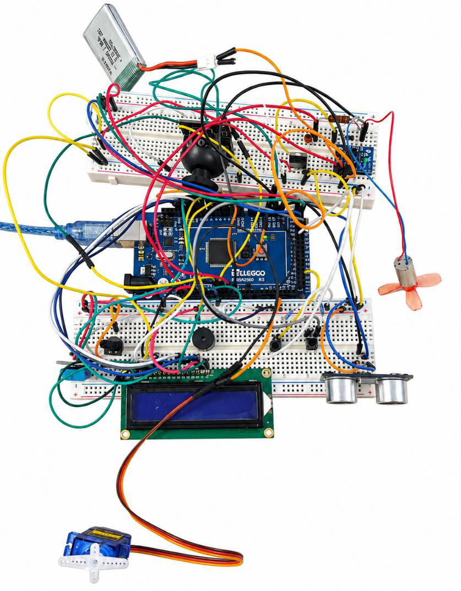
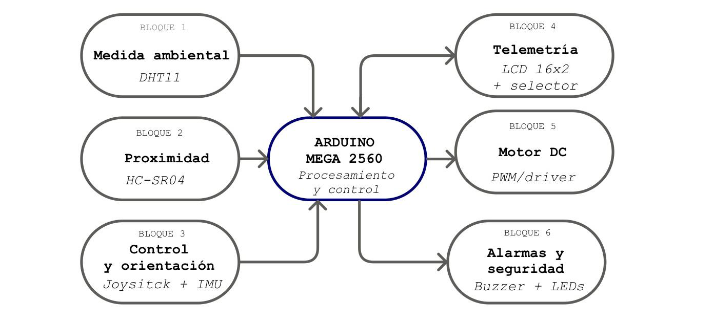
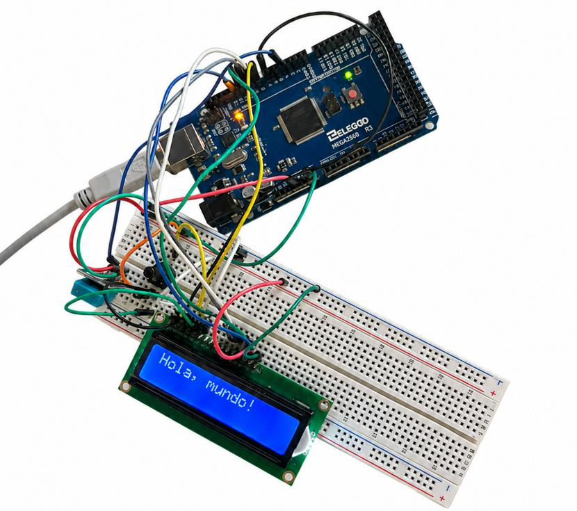
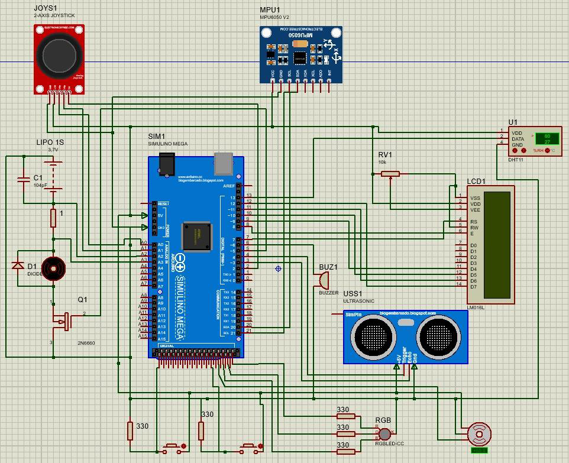

# Drone Control and Safety System

Arduino Mega prototype that integrates the measurement, control and safety functions of an unmanned aerial vehicle: motor control, environmental and distance sensing, attitude measurement, battery monitoring and LCD telemetry in a single non-blocking program.

The project was developed in the Aerospace Systems Engineering degree at EETAC (UPC).



## Overview

An Arduino Mega 2560 reads all the sensors, drives the actuators and shows the telemetry on a 16 × 2 LCD. The motor is controlled manually with a joystick, and the program corrects the throttle automatically depending on the inclination of the system, the proximity of obstacles and the state of the battery.



## Features

- DC motor throttle control with a joystick and PWM, with a safety stop button
- Temperature and humidity measurement with a DHT11 sensor
- Distance measurement with an HC-SR04 ultrasonic sensor, compensated with the measured temperature
- Proximity alarm with a buzzer below 20 cm
- Pitch and roll measurement with an MPU6050 IMU, with a calibration button
- Servo that follows the pitch angle with a low-pass filter
- Battery voltage, motor current and accumulated consumption (mAh) with a shunt resistor
- RGB LED indicator of the battery level
- Low-battery mode with hysteresis that limits the throttle for landing
- Four telemetry pages on the LCD, selected with a push button
- Event-driven, non-blocking main loop based on `millis()`, `micros()` and an interrupt

## Hardware

- Arduino Mega 2560
- 16 × 2 LCD display
- DHT11 temperature and humidity sensor
- HC-SR04 ultrasonic sensor
- GY-521 module (MPU6050 IMU)
- Analog joystick with push button
- Brushed DC motor, IRLZ44N MOSFET and flyback diode
- 1S LiPo battery and 1 Ω shunt resistor
- Servomotor, buzzer, RGB LED and push buttons

## System design

### Environment and proximity

The DHT11 is read every 3 seconds without blocking the program. The ultrasonic echo is captured with an external interrupt, and the distance is calculated with the speed of sound corrected by temperature and a linear calibration obtained experimentally:

```
v = 331.4 + 0.6 · T                     (m/s, with T in °C)
d_cal = 1.00338 · d − 0.2136            (cm)
```

### Orientation

The pitch and roll angles are calculated from the accelerometer of the MPU6050. A calibration button stores the current orientation as the zero reference, which removed the initial offsets of about 11° in roll and 3° in pitch and left a variation of about ±0.1°.

```
pitch = −atan2(ax, √(ay² + az²))
roll  =  atan2(ay, az)
```

The IMU is read with a time limit, so a loose cable cannot freeze the program: the sensor is marked as lost and reconnected automatically.

### Motor and throttle

The joystick Y axis sets the base throttle and the X axis arms the motor, which stays enabled until the safety button is pressed. The final PWM value combines:

| Contribution | Behaviour |
| --- | --- |
| Joystick | Base throttle from 0 to 255 |
| Stabilization | Increases linearly with the largest tilt angle, up to the maximum at 45° |
| Impact avoidance | Extra power when an obstacle is at 15 cm or less |
| Low battery | Throttle limited to 40 % and motor stopped at 5 cm or less, to land |

### Electrical telemetry

The current is obtained from the voltage at both sides of the shunt resistor, averaged over 20 samples to filter the PWM ripple. The accumulated consumption is integrated with the trapezoidal rule. The low-battery mode is entered below 3.5 V and left above 3.7 V, which prevents the motor from oscillating when the voltage recovers.

### LCD telemetry

| Page | Information |
| --- | --- |
| 0 | Temperature and humidity |
| 1 | Distance to the obstacle |
| 2 | Average current, battery voltage and accumulated consumption |
| 3 | Pitch and roll |

The display is refreshed every 250 ms and only the characters that change are written, one per loop cycle, to keep the loop time short.



## Circuit design



## Pin configuration

| Arduino pin | Function |
| --- | --- |
| A0, A1 | Joystick X and Y axes |
| A2, A3 | Battery voltage and low side of the shunt resistor |
| D2 | Joystick button (safety stop) |
| D3 | Ultrasonic echo (external interrupt) |
| D4 | Ultrasonic trigger |
| D5 | DC motor PWM control |
| D6 | Buzzer |
| D7 – D12 | LCD |
| D13 | DHT11 |
| D20, D21 | IMU (SDA, SCL) |
| D22, D24, D26 | RGB LED |
| D28 | Servo |
| D31 | IMU calibration button |
| D53 | LCD page button |

## Arduino code

The Arduino sketch is available in:

```
Arduino/DroneControlSafetySystem/DroneControlSafetySystem.ino
```

Required libraries:

- `LiquidCrystal`, `Servo` and `Wire` (included with the Arduino IDE)
- `dht_nonblocking`
- `MPU6050` by Jarzebski: https://github.com/jarzebski/Arduino-MPU6050

## Running the project

1. Install the libraries in the Arduino IDE.
2. Open the sketch and select the Arduino Mega 2560 board and the serial port.
3. Build the circuit following the pin configuration and the circuit design.
4. Upload the sketch and open the Serial Monitor at 9600 baud to see the telemetry.
5. Press the calibration button with the system level, move the joystick X axis to arm the motor and use the Y axis as throttle.

## Repository structure

| Path | Content |
| --- | --- |
| `Arduino/` | Arduino sketch |
| `images/` | Block diagram, circuit design and prototype pictures |
| `docs/Memoria_Tecnica.pdf` | Technical report (in Spanish) |

## Technologies

- Arduino Mega 2560
- Embedded C/C++ (Arduino sketch)
- I²C, external interrupts and PWM
- Sensor integration and calibration
- Non-blocking, event-driven firmware
- Proteus circuit design

## Contributors

- Ferran Alegre Baltasar - [@ferran-alegre](https://github.com/ferran-alegre)
- Estela Arana
- Adrià Expósito
- Lucía Mira
